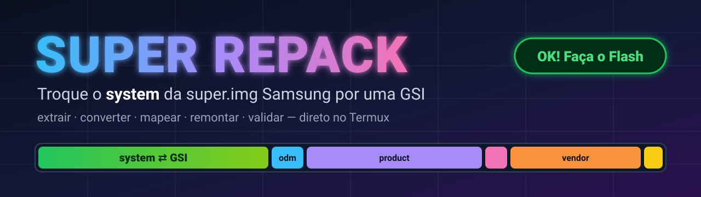
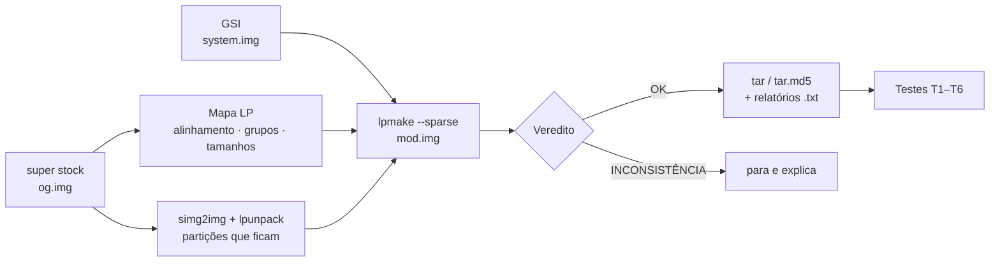

<p align="center">
  
</p>

<p align="center">
  <a href="LICENSE"></a>
  
  
  
  
  
  
</p>

<p align="center">
  <a href="https://github.com/Saulo5810p/super-repack/stargazers"></a>
  <a href="https://github.com/Saulo5810p/super-repack/issues"></a>
  <a href="https://github.com/Saulo5810p/super-repack/commits/main"></a>
  
  
</p>

<p align="center"><b>Troque o <code>system</code> da <code>super.img</code> Samsung por uma GSI — extraindo, convertendo, remontando e <u>validando</u> tudo pelo Termux, sem PC.</b></p>

---

## ✨ Recursos

- 🧭 **Interativo e à prova de erro** — pede o caminho de **cada** arquivo, mostra tipo e tamanho e pede confirmação. Aceita `~`, caminho relativo à HOME, aspas e <kbd>Tab</kbd>.
- 📥 **Organiza a home do Termux** — o que estiver fora dela é copiado como `og.img` (original), `mod.img` (modificada) ou `gsi.img`.
- 🗺️ **Mapa automático da super stock** — alinhamento, primeiro setor, slots, grupos, atributos e tamanhos são **lidos** do original, nunca digitados.
- 📐 **Reproduz o alinhamento original** (1 MiB nas supers Samsung típicas), o ponto em que montagens manuais costumam errar.
- 🧾 **Relatórios no formato `lpdump` + extras** — alinhamento, tamanho e SHA-256 de cada imagem interna, da super original e da remontada.
- ✅ **Veredito automático** — `OK! Faça o Flash` ou `INCONSISTÊNCIA! Verifique e corrija os erros`.
- 🔁 **Testes de idempotência** — remontagem repetida idêntica byte a byte, conteúdo do tar, md5 e mais.
- 🔍 **Modo VALIDAR** — compara qualquer `og.img` com uma `mod.img` já pronta.
- 📦 Entradas: super **sparse/raw/.lz4**; GSI **raw/sparse/.xz/.gz**. Saída: `.tar` e/ou `.tar.md5` para o slot **AP** do Odin.

## 🚀 Início rápido

```bash
# Termux
pkg install python file diffutils tar coreutils
git clone https://github.com/Saulo5810p/super-repack.git
cd super-repack
bash super_repack.sh
```

**Requisitos**

| Ferramenta | Para quê | Observação |
|---|---|---|
| `lpmake`, `lpunpack`, `simg2img` | montar / extrair / converter sparse | ferramentas do AOSP (build ARM64). **Não vêm neste repositório**: precisam estar no `PATH` |
| `python3` | leitor de metadados LP embutido | |
| `file`, `tar`, `cmp`, `sha256sum`, `md5sum`, `realpath` | conferências e empacotamento | `pkg install file diffutils tar coreutils` |
| `lz4` / `xz` | só se a super vier `.lz4` / a GSI vier `.xz` | |

O script avisa exatamente o que estiver faltando.

## 🧭 Como funciona



Detalhes em [`docs/COMO-FUNCIONA.md`](docs/COMO-FUNCIONA.md).

## ✅ Como o veredito é decidido

“Tudo igual” não existe: o `system` muda de tamanho e as partições seguintes mudam de lugar. Então o script compara:

| Precisa ser **igual** ao original | Precisa **mudar como previsto** |
|---|---|
| metadata (versão, tamanho, slots), primeiro setor, alinhamento, tamanho da super, grupos e máximos, ordem e atributos, tamanho e **SHA-256** das partições intactas | tamanho e SHA-256 do `system` (= GSI); posição das demais (= regra de alinhamento recalculada) |

## 📄 Arquivos gerados

| Arquivo | Conteúdo |
|---|---|
| `mod.img` | a super remontada (sparse), na home do Termux |
| `*.tar` / `*.tar.md5` | pacote para o slot **AP** do Odin (`super.img` na raiz) |
| `super_original_lpdump.txt` | partições, extents, layout, block device e grupos da original + alinhamento, tamanhos e SHA-256 |
| `super_new_lpdump.txt` | o mesmo, da remontada |
| `super_validacao.txt` | tabela campo a campo e veredito |

Exemplos reais (Galaxy A35) em [`examples/galaxy-a35`](examples/galaxy-a35).

## 🖥️ Exemplo de saída

```text
Comparacao: 41 campos IGUAIS | 7 ESPERADOS (mudam como previsto) | 0 DIVERGENTES
system: tamanho (bytes)           6516895744   2119327744   ESPERADO (= GSI)
odm: setor inicial                12730368     4143104      ESPERADO (reposicionada)
OK! Faca o Flash

============================================
  OK! Faça o Flash
============================================
```

## 🧪 Testes de idempotência

| Teste | Verifica |
|---|---|
| T1 | o tar contém `super.img` na raiz |
| T2 | `super.img` dentro do tar == super gerada |
| T3 | md5 no fim do `.tar.md5` confere (quando gerado) |
| T4 | remontar de novo com as mesmas entradas gera arquivo **idêntico byte a byte** |
| T5 | leitura do mapa é estável |
| T6 | os três relatórios foram gerados |

## ⚠️ Avisos importantes

- **O script não grava nada no aparelho.** Ele só prepara e valida a imagem.
- Gravar a `super` pode deixar o aparelho sem boot. Tenha o **firmware stock completo** à mão e o bootloader desbloqueado (isso pode anular a garantia e acionar o Knox).
- Um veredito `OK` garante que a **estrutura e os dados** da super batem com o original. Ele **não** garante que a GSI seja compatível com o vendor, nem cobre `vbmeta`, `fstab` ou limpeza do `/data`.
- Muitas GSIs exigem limpar o `/data` no primeiro boot.

## 🧩 Status e limitações

- Validado com supers do **Galaxy A35** (layout não-A/B, 2 slots de metadata, alinhamento de 1 MiB) — ajuste o modelo conforme o seu teste.
- Troca **uma** partição por execução (padrão: `system`).
- Testados com dados reais/sintéticos: super sparse, GSI sparse e `.xz`, caminhos com espaço e aspas. Os caminhos de entrada `.lz4` (super) e `.gz` (GSI) estão implementados, mas **ainda não foram testados**.
- Não testado em layouts **A/B virtuais** (`_a`/`_b`) nem com mais de um *block device*.

## 🛠️ Solução de problemas

| Sintoma | O que fazer |
|---|---|
| `cannot execute binary file` | cópia ruim do arquivo; baixe de novo e confira com `file super_repack.sh` |
| `lpunpack` sem suporte a `-p` | o script cai sozinho para a extração completa |
| pouco espaço | o script estima o pico antes de começar; use uma pasta de trabalho em armazenamento com mais espaço |
| `INCONSISTÊNCIA!` | leia a seção `PROBLEMAS:` e o `super_validacao.txt`; **não grave** |

## 🤝 Contribuindo

Issues e PRs são bem-vindos. Ao reportar um problema, anexe o `super_repack.log`, o `super_validacao.txt` e o modelo do aparelho.

## 🙏 Créditos e projetos relacionados

- Ferramentas `lpmake`, `lpunpack` e `simg2img` do **Android Open Source Project** (Apache 2.0). O formato de metadata segue o `liblp` do AOSP.
- Projeto relacionado: [Custom-Super-Maker](https://github.com/minhmc2007/Custom-Super-Maker), que resolve um problema parecido sob outra licença. **Este repositório é independente e não contém código dele.**
- Desenvolvido com a assistência do **Claude** (Anthropic).

## 📜 Licença

[Apache License 2.0](LICENSE) © 2026 XaulinXs Foundry. Veja também o [`NOTICE`](NOTICE).
As imagens de ROM/GSI usadas como entrada pertencem aos seus respectivos autores.

---

## 🇬🇧 English summary

**super-repack** replaces the `system` partition inside a Samsung dynamic-partition `super.img` (sparse) with a GSI, entirely from Termux. It reads the stock LP metadata (alignment, groups, attributes, sizes), rebuilds with `lpmake --sparse` using the **same** alignment, produces `lpdump`-style reports with SHA-256 per partition, and prints a verdict: `OK! Faça o Flash` or `INCONSISTÊNCIA!`. It never flashes anything. Requires AOSP `lpmake`, `lpunpack`, `simg2img` (not bundled) and Python 3. Licensed under Apache 2.0.
# super-repack
# super-repack
